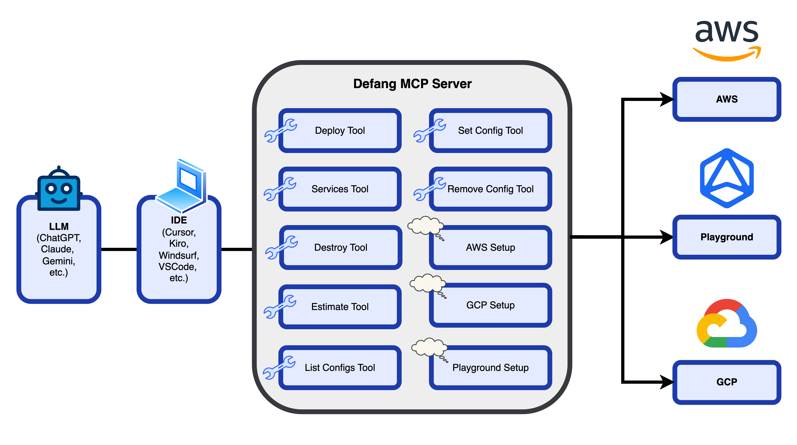
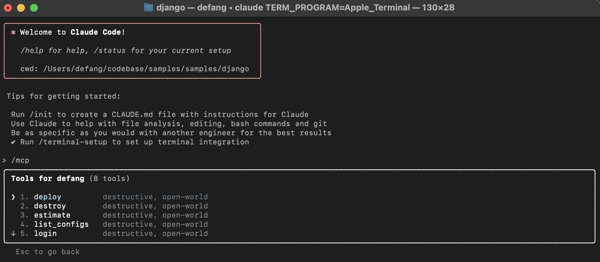
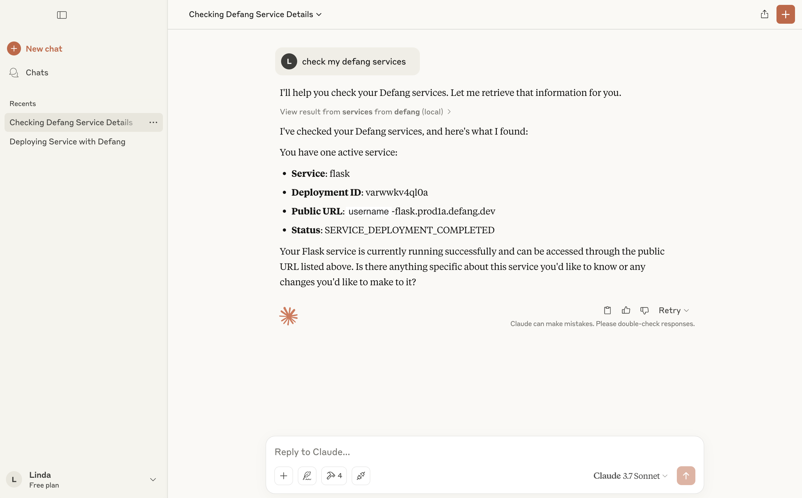
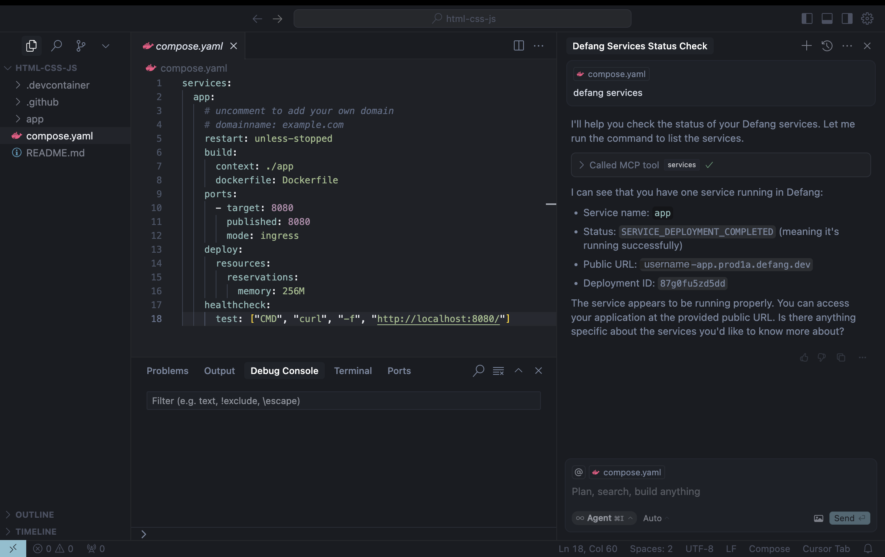
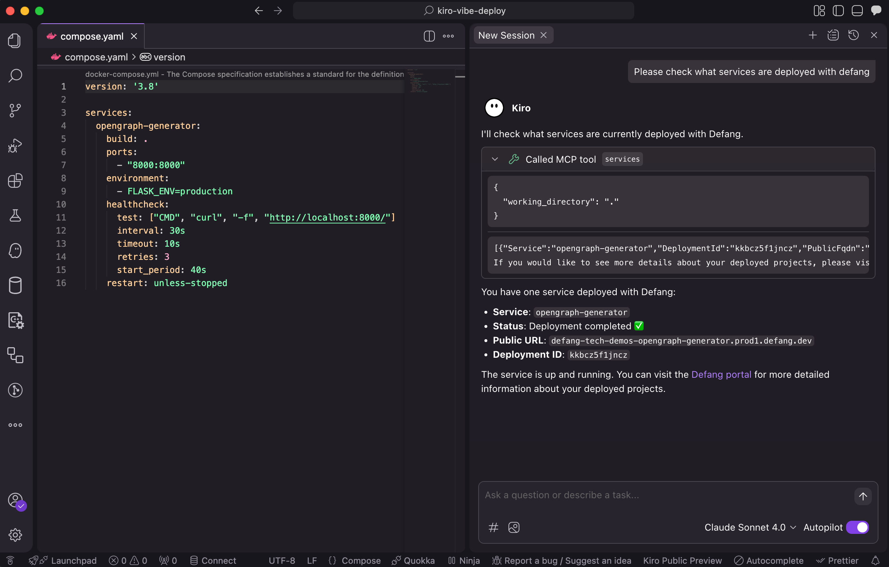
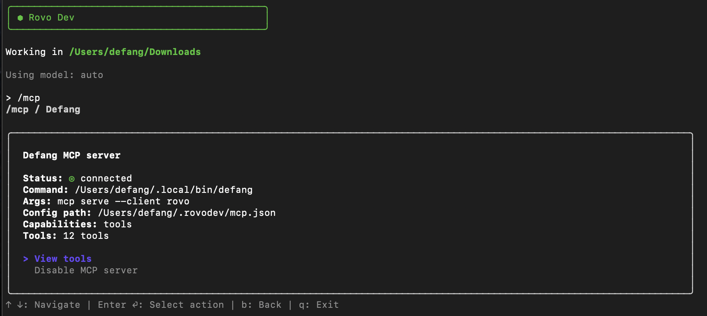
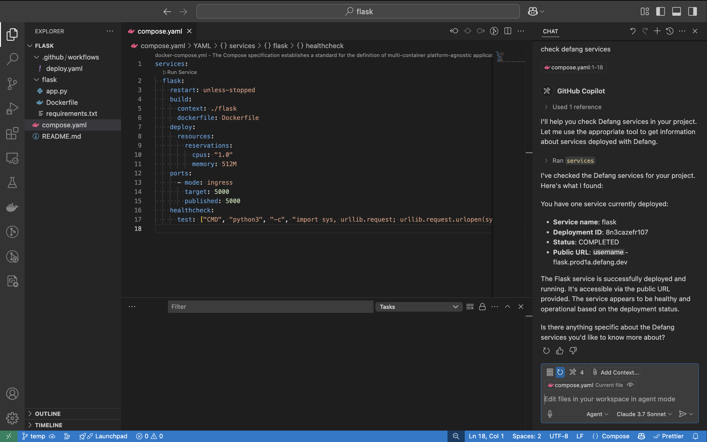
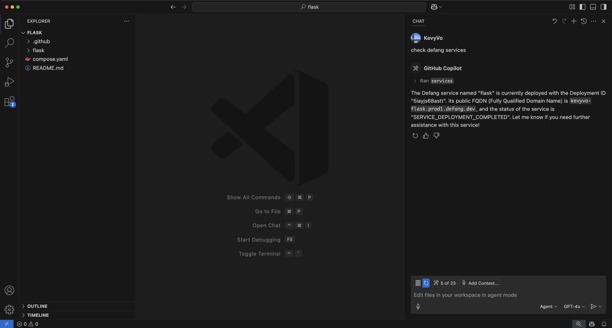
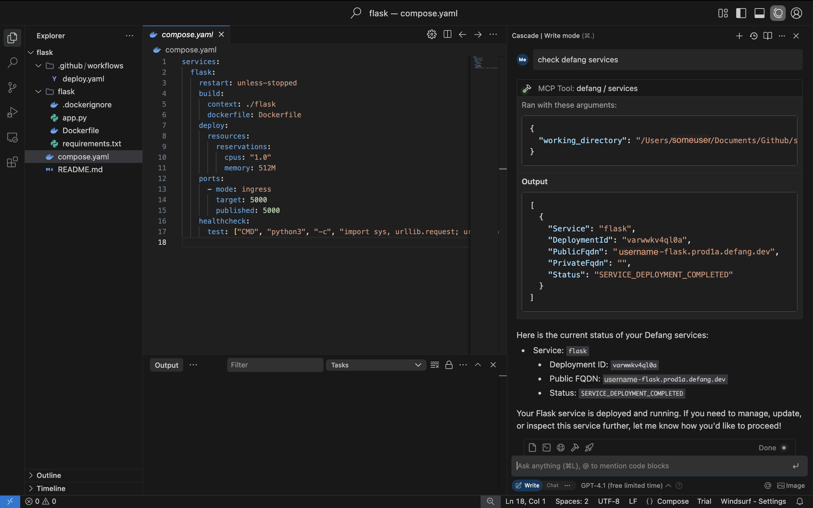

# Model Context Protocol (MCP) Server

The Defang [Model Context Protocol (MCP) Server](https://github.com/DefangLabs/defang/tree/main/src/pkg/mcp) includes built-in tools to allow users to deploy and manage cloud services through a supported IDE.

Using this MCP Server with an IDE will enable the AI coding agent (e.g. Copilot) to use Defang tools and resources to perform tasks, such as deploying a service to the cloud. This means you can now use Defang with IDE-integrated AI coding agents.



For more details about MCP architecture, visit the [official MCP documentation](https://modelcontextprotocol.io/introduction).

info

This page is a guide to the Defang MCP Server detailing its installation, tools, and usage. If you are looking for an example of how you can deploy a MCP project with Defang, please instead refer to our [MCP sample application](https://github.com/DefangLabs/samples/tree/main/samples/mcp).

## Installation[​](#installation "Direct link to Installation")

Ensure that you have the [Defang CLI](https://docs.defang.io/docs/intro/getting-started.md#install-the-defang-cli) installed.

Run the setup command in your terminal for your IDE of choice from the [Supported IDEs](#supported-ides) section. This will connect the Defang MCP Server to your IDE. The general format of the command is as follows:

Recommended Installation

Install the [Defang CLI](https://docs.defang.io/docs/intro/getting-started.md#install-the-defang-cli) using [Curl](https://curl.se/) or [Homebrew](https://brew.sh/)

```
defang mcp setup --client=<claude-code|claude-desktop|codex|cursor|kiro|rovo|vscode|vscode-codespaces|vscode-insiders|windsurf>
```

Once the command completes, you may need to restart your IDE for the changes to take effect.

Once the MCP Server is running, you can access the Defang MCP tools directly through the AI agent chat in your IDE.

That's it! Feel free to explore our [Example Prompts](#example-prompts) to get ideas on how to interact with the AI agent and make the most of the Defang MCP Server.

Note that `npx` installation is supported, but not recommended.

```
npx -y defang@latest mcp setup --client=<claude-code|claude-desktop|codex|cursor|kiro|rovo|vscode|vscode-codespaces|vscode-insiders|windsurf>
```

## Supported IDEs[​](#supported-ides "Direct link to Supported IDEs")

### [Claude Code](https://www.claude.com/product/claude-code)[​](#claude-code "Direct link to claude-code")

While this is not an IDE in the traditional sense, it can support MCP servers. For a smoother experience, consider specifying a project name or directory when making chat prompts to this platform.

Setup command:

```
defang mcp setup --client=claude-code
```

Once setup is complete, you can interact with the AI coding agent using Defang-related actions like `check defang services` or [other prompts](#example-prompts). Here's an example of what it could look like:



### [Claude Desktop](https://claude.com/download)[​](#claude-desktop "Direct link to claude-desktop")

While this is not an IDE in the traditional sense, it can support MCP servers. For a smoother experience, consider specifying a project name or directory when making chat prompts to this platform.

Setup command:

```
defang mcp setup --client=claude-desktop
```

Once setup is complete, you can interact with the AI coding agent using Defang-related actions like `check defang services` or [other prompts](#example-prompts). Here's an example of what it could look like:



### [Codex](https://developers.openai.com/codex)[​](#codex "Direct link to codex")

Setup command:

```
defang mcp setup --client=codex
```

### [Cursor](https://cursor.com/)[​](#cursor "Direct link to cursor")

Setup command:

```
defang mcp setup --client=cursor
```

Once setup is complete, you can interact with the AI coding agent using Defang-related actions like `check defang services` or [other prompts](#example-prompts). Here's an example of what it could look like:



### [Kiro](https://kiro.dev/)[​](#kiro "Direct link to kiro")

Setup command:

```
defang mcp setup --client=kiro
```

Once setup is complete, you can interact with the AI coding agent using Defang-related actions like `check defang services` or [other prompts](#example-prompts). Here's an example of what it could look like:



### [Rovo](https://support.atlassian.com/rovo/docs/use-rovo-dev-cli/)[​](#rovo "Direct link to rovo")

While this is not an IDE in the traditional sense, it can support MCP servers. For a smoother experience, consider specifying a project name or directory when making chat prompts to this platform.

Setup command:

```
defang mcp setup --client=rovo
```

Once setup is complete, you can interact with the AI coding agent using Defang-related actions like `check defang services` or [other prompts](#example-prompts). Here's an example of what it could look like:



### [VS Code](https://code.visualstudio.com/)[​](#vs-code "Direct link to vs-code")

Setup command:

```
defang mcp setup --client=vscode
```

Once setup is complete, you can interact with the AI coding agent using Defang-related actions like `check defang services` or [other prompts](#example-prompts). Here's an example of what it could look like:



### VS Code in GitHub Codespaces[​](#vs-code-in-github-codespaces "Direct link to VS Code in GitHub Codespaces")

Setup command:

```
defang mcp setup --client=vscode-codespaces
```

### [VS Code Insiders](https://code.visualstudio.com/insiders/)[​](#vs-code-insiders "Direct link to vs-code-insiders")

Setup command:

```
defang mcp setup --client=vscode-insiders
```

Once setup is complete, you can interact with the AI coding agent using Defang-related actions like `check defang services` or [other prompts](#example-prompts). Here's an example of what it could look like:



### [Windsurf](https://windsurf.com/)[​](#windsurf "Direct link to windsurf")

Setup command:

```
defang mcp setup --client=windsurf
```

Once setup is complete, you can interact with the AI coding agent using Defang-related actions like `check defang services` or [other prompts](#example-prompts). Here's an example of what it could look like:



## MCP Tools[​](#mcp-tools "Direct link to MCP Tools")

The Defang MCP Server provides 15 tools. It also provides two read-only resources with Defang's knowledge base and sample projects. It does not provide MCP prompts.

Prerequisite

The tools that deploy and manage a project work on the currently selected stack. Create one with `create_aws_stack`, `create_gcp_stack` or `create_azure_stack`, or select an existing one with `select_stack`.

### Deploy and inspect[​](#deploy-and-inspect "Direct link to Deploy and inspect")

| Tool           | What it does                                                                                                                                                |
| -------------- | ----------------------------------------------------------------------------------------------------------------------------------------------------------- |
| `deploy`       | Deploys the Compose project in the current working directory to the selected stack.                                                                         |
| `destroy`      | Destroys the deployed application in the selected stack.                                                                                                    |
| `services`     | Lists the deployed services for the project in the selected stack.                                                                                          |
| `logs`         | Fetches logs for the application in the selected stack, up to 100 lines at a time. Use the `since` and `until` parameters to page through the logs by time. |
| `project_name` | Returns the current project name.                                                                                                                           |

### Stacks[​](#stacks "Direct link to Stacks")

| Tool                 | What it does                                                                                 |
| -------------------- | -------------------------------------------------------------------------------------------- |
| `create_aws_stack`   | Creates a [stack](https://docs.defang.io/docs/concepts/stacks.md) file for deploying to AWS. |
| `create_gcp_stack`   | Creates a stack file for deploying to Google Cloud.                                          |
| `create_azure_stack` | Creates a stack file for deploying to Azure.                                                 |
| `list_stacks`        | Lists the stacks for the current project.                                                    |
| `select_stack`       | Selects the stack to deploy to.                                                              |
| `current_stack`      | Returns the currently selected stack.                                                        |

### Configuration[​](#configuration "Direct link to Configuration")

| Tool            | What it does                                                                                                                                                                             |
| --------------- | ---------------------------------------------------------------------------------------------------------------------------------------------------------------------------------------- |
| `list_configs`  | [Lists](https://docs.defang.io/docs/cli/defang_config.md) the config variables set for the selected stack.                                                                               |
| `set_config`    | [Sets](https://docs.defang.io/docs/tutorials/configure-environment-variables.md#step-2---set-the-actual-value-in-the-defang-cli) a config variable. It can also generate a random value. |
| `remove_config` | [Removes](https://docs.defang.io/docs/tutorials/configure-environment-variables.md#removing-a-config-value) a config variable.                                                           |

### Cost estimates[​](#cost-estimates "Direct link to Cost estimates")

warning

Cost estimation is temporarily unavailable. Follow [issue #2316](https://github.com/DefangLabs/defang/issues/2316) for the fix and its release.

The `estimate` tool takes your project and a [deployment mode](https://docs.defang.io/docs/concepts/deployment-modes.md) and returns a [cost estimation](https://docs.defang.io/docs/concepts/estimation.md). It supports AWS and Google Cloud.

## Example Prompts[​](#example-prompts "Direct link to Example Prompts")

After connecting the Defang MCP Server to your IDE using an installation method, you can type in prompts in your chat to invoke the AI agent to use any MCP tool(s).

For example, you can ask the AI agent:

```
can you deploy this to defang?
```

```
please destroy this project.
```

```
what services do I have?
```

You can also choose to specify a project name or project directory if you do not have the project open:

```
deploy this with defang /Users/yourname/Documents/project1
```

```
do I have a service called project1
```

You can ask for a cost estimate for a supported cloud provider. Cost estimation is currently unavailable (see [Cost estimates](#cost-estimates)):

```
can you estimate balance mode on aws for this project?
```

```
can you estimate how much this project will cost on gcp?
```

You can list, set and remove Defang configs for a project:

```
what defang configs do I have set for this project?
```

```
list all the defang configs I have set for this project
```

```
set the defang config DATABASE_URL to example.com
```

```
remove the defang config DATABASE_URL
```

Feel free to try any of these prompts or create your own!

## Manual Setup[​](#manual-setup "Direct link to Manual Setup")

If you prefer to set up the Defang MCP Server manually without using the setup command and without installing the [Defang CLI](https://docs.defang.io/docs/intro/getting-started.md#install-the-defang-cli), you can copy this MCP configuration into your IDE's MCP file:

```
{
  "mcpServers": {
    "defang": {
      "command": "npx",
      "args": ["-y", "defang@latest", "mcp", "serve"]
    }
  }
}
```
