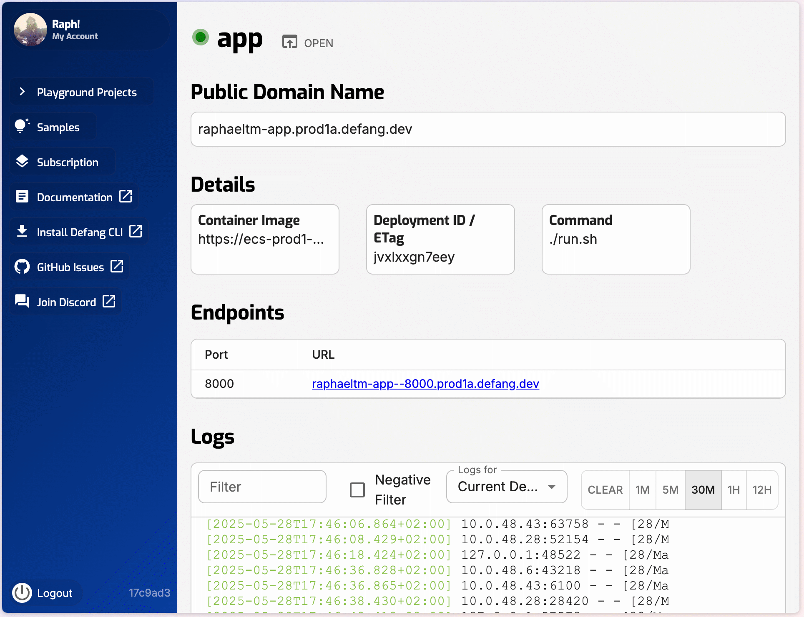

# Getting Started

## Install the Defang CLI[​](#install-the-defang-cli "Direct link to Install the Defang CLI")

Defang Deploy doesn't require installing anything in your cloud, but you will need to install the [open source](https://github.com/DefangLabs/defang) Defang command line interface (CLI) to interact with your Defang resources and account.

We offer a few different ways to install the Defang CLI. You can use a shell script, Homebrew, Winget, or you can download the binary directly.

* Shell
* Homebrew
* Winget
* Nix
* Direct Download

**Using a shell script**

You can install the Defang CLI using a shell script. Run the following command in your terminal:

```
eval "$(curl -fsSL s.defang.io/install)"
```

The script will try to download the appropriate binary for your operating system and architecture, add it to `~/.local/bin`, and add `~/.local/bin` to your `PATH` if it's not already there, with your permission. If you do not provide permission it will print an appropriate instruction for you to follow to add it manually. You can also customize the installation directory by setting the `INSTALL_DIR` environment variable before running the script.

**Using Homebrew**

You can easily install the Defang CLI using [Homebrew](https://brew.sh/). Run the following command in your terminal:

```
brew install DefangLabs/defang/defang
```

**Using Winget**

On Windows, you can install the Defang CLI using `winget`. Run the following command in your terminal:

```
winget install defang
```

**Using Nix**

```
nix profile install github:DefangLabs/defang#defang-bin --refresh
```

**Direct Download**

You can find the latest version of the Defang CLI on the [latest release page](https://github.com/DefangLabs/defang/releases/latest). Just download the appropriate binary for your operating system and architecture, and put it somewhere in your `PATH`.

## Generate a project[​](#generate-a-project "Direct link to Generate a project")

```
$ defang generate nodejs-http
```

You should see the following prompt:

```
? What folder would you like to create the project in?
```

Type in the name of the folder you'd like to use for your new project and press ENTER.

I'll type `"welcome-to-defang"`. Now, you'll see the following output:

```
? What folder would you like to create the project in? welcome-to-defang
 * Fetching sample from the Defang repository...
 * Writing files to disk...
   - .github/
   - .github/workflows/
   - .github/workflows/deploy.yaml
   - README.md
   - app/
   - app/Dockerfile
   - app/main.js
   - compose.yaml
 * Code generated successfully in folder welcome-to-defang

Check the files in your favorite editor.
To deploy the service, do `cd welcome-to-defang` and

  defang compose up
```

Now, navigate to the folder you just created:

```
$ cd welcome-to-defang
```

You can open the folder in your favorite editor and see the files that were generated for you:

* The `app` folder contains the code for your service.
* The `Dockerfile` is used to build the container image for your service.
* The `compose.yaml` file is used to define the services you want to deploy.

## Deploy to the Playground[​](#deploy-to-the-playground "Direct link to Deploy to the Playground")

Go back to your shell and type the following:

```
$ defang compose up
```

If you have not used Defang before, you'll be prompted to log in.

```
 ! Please log in to continue.
Please visit http://127.0.0.1:49154 and log in. (Right click the URL or press ENTER to open browser)
```

info

To learn more about how authentication works in Defang, check out our [Authentication](https://docs.defang.io/docs/concepts/authentication.md) page.

When you do this, you should see something similar to the output below:

```
 * Uploading build context for app
 * Deploying service app
 * Monitor your services' status in the defang portal
   - https://portal.defang.dev/service/app
 * Tailing logs for deployment ID o59k89vk3qc8 ; press Ctrl+C to detach:
 * Press V to toggle verbose mode
2024-09-19T10:50:53.572443-07:00 cd Update started for stack jordanstephens-prod1
2024-09-19T10:51:05.536299-07:00 cd Update succeeded in 11.99769745s ; provisioning...
2024-09-19T10:51:39.419693-07:00 app Server running at http://0.0.0.0:3000/
 * Service app is in state DEPLOYMENT_COMPLETED and will be available at:
   - https://jordanstephens-app--3000.prod1.defang.dev
 * Done.
```

Now we can go to <https://portal.defang.dev/service/app> to see our service listed in the Defang portal.



## Next Steps[​](#next-steps "Direct link to Next Steps")

Congratulations! You've successfully deployed your first service with Defang Deploy. Now, where do you go from here?

Defang Deploy supports various ways of creating and deploying services to the cloud. The following tutorials dive into each one in more detail:

## [📄️<!-- --> <!-- -->Deploy to your own cloud](https://docs.defang.io/docs/tutorials/deploy-to-your-cloud.md)

[When you're ready for production](https://docs.defang.io/docs/tutorials/deploy-to-your-cloud.md)

## [📄️<!-- --> <!-- -->Generate a Project with AI](https://docs.defang.io/docs/tutorials/generate-new-code-using-ai.md)

[Use Defang Deploy to generate and deploy a new project](https://docs.defang.io/docs/tutorials/generate-new-code-using-ai.md)

## [📄️<!-- --> <!-- -->Explore the Defang CLI](https://docs.defang.io/docs/cli.md)

[Learn more about the Defang CLI](https://docs.defang.io/docs/cli.md)

## [📄️<!-- --> <!-- -->Learn more about Defang Deploy](https://docs.defang.io/docs/intro/what-is-defang.md)

[What is Defang Deploy and how does it work?](https://docs.defang.io/docs/intro/what-is-defang.md)

## [📄️<!-- --> <!-- -->Deploy using Pulumi](https://docs.defang.io/docs/tutorials/deploy-using-pulumi.md)

[Deploy using Pulumi](https://docs.defang.io/docs/tutorials/deploy-using-pulumi.md)

## [📄️<!-- --> <!-- -->Monitor your services](https://docs.defang.io/docs/tutorials/monitoring-your-services.md)

[Learn how to monitor your services with Defang Deploy](https://docs.defang.io/docs/tutorials/monitoring-your-services.md)

Choose the direction that seems the most interesting. If you have any questions, join the [Defang Discord](https://discord.gg/defang) and we'll be happy to help you out.
