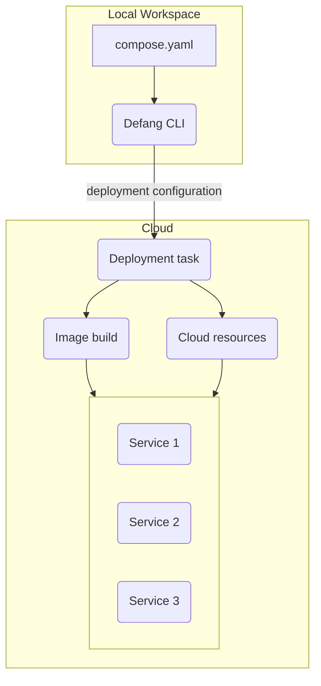

# How Defang Deploy Works

Defang Deploy takes your Docker Compose application to your cloud account. The `defang` CLI prepares the resources needed for deployment and starts a short-lived deployment task, called CD, in your cloud account.

## Bootstrapping

When you deploy, the CLI prepares or reuses supporting resources in your cloud account, such as permissions and storage, and starts a CD task. The task uses your deployment configuration to build images and provision your application's resources. The resources and services used depend on your cloud provider; see the [provider docs](/docs/providers) for details.

:::info
The CD task runs for deployment operations and exits when its work is complete. Your deployed services continue running independently.
:::

## Orchestrating Deployments

The CLI passes your deployment configuration, including your Compose file and [recipe](/docs/concepts/recipe), to the CD task. CD orchestrates image builds and provisions the resources needed to run your application.

:::info
The `defang` CLI uploads local build contexts to storage in your cloud. Your source code is never processed by Defang's servers.
:::

## Building Images

For services built from local source, the CLI uploads the build context to storage in your cloud account. CD starts the build using services appropriate to your provider and deploys the resulting image. Services that specify an existing image can use that image instead.

## Service Provisioning

After your images have been built, `CD` will provision the necessary resources and deploy these images as new services in your cloud account. Defang uses the cloud provider's SDK to create the necessary resources for your services. This may include creating new containers, setting up networking, and configuring any other resources your services needs, such as storage resources.

When deploying changes to existing services, the `CD` task will determine the minimum set of changes necessary and add, remove, replace, or update services as necessary.
