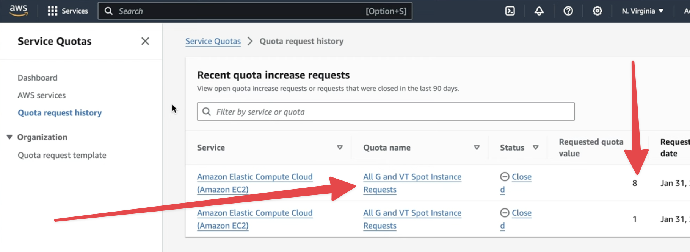

# Deploy a GPU-Powered Application to AWS

This tutorial will show you how to create and deploy a GPU-powered application on AWS using Defang.

We will walk you through the whole deployment process based on the [Mistral & vLLM](https://github.com/DefangLabs/samples/tree/main/samples/vllm) sample.

[YouTube video player](https://www.youtube.com/embed/kynFa2zU7hQ?si=qdV0xa6vkhMFJ6qv)

## Prerequisites[​](#prerequisites "Direct link to Prerequisites")

* [A Defang Account](https://docs.defang.io/docs/concepts/authentication.md)
* [The Defang CLI](https://docs.defang.io/docs/intro/getting-started.md#install-the-defang-cli)
* [AWS Account Credentials](https://docs.defang.io/docs/tutorials/setting_up_your_aws_account.md)

### AWS Account with GPU Access[​](#aws-account-with-gpu-access "Direct link to AWS Account with GPU Access")

For any of this to work, you'll need to have access to GPU instances in your AWS account. To do that you'll need to go to the "[Service Quotas](https://console.aws.amazon.com/servicequotas/home)" console in your AWS account. From there you can request access to spot GPU instances. You'll need to request 8 or more because the value is per vCPU and the smallest GPU instance has 8 vCPUs. The instance types you're requesting are "All G and VT spot instances".

Timing

This process can take a few days for AWS to approve.



### HuggingFace Token[​](#huggingface-token "Direct link to HuggingFace Token")

This sample requires a HuggingFace token to download the model. You can get a token by signing up at [HuggingFace](https://huggingface.co/join) and then going to [your settings](https://huggingface.co/settings/tokens) to get your token.

## Step 1 - Clone the sample project[​](#step-1---clone-the-sample-project "Direct link to Step 1 - Clone the sample project")

You'll need to clone the [Mistral & vLLM](https://github.com/DefangLabs/samples/tree/main/samples/vllm) sample to go through this tutorial.

## Step 2 - Check your [Defang BYOC](https://docs.defang.io/docs/concepts/defang-byoc.md) settings[​](#step-2---check-your-defang-byoc-settings "Direct link to step-2---check-your-defang-byoc-settings")

* Make sure you [install the latest version of the Defang CLI](https://docs.defang.io/docs/intro/getting-started.md#install-the-defang-cli)
* Then, make sure you have properly [authenticated your AWS account](https://docs.aws.amazon.com/cli/latest/userguide/cli-chap-configure.html). The Defang CLI makes use of AWS environment variables like `AWS_PROFILE`, `AWS_REGION`, `AWS_ACCESS_KEY_ID`, and `AWS_SECRET_ACCESS_KEY`, so make sure the correct values are set for those.

tip

If you have the AWS CLI installed (which is not required in order to use the Defang CLI), you can verify that you've authenticated to AWS by running `aws sts get-caller-identity` and see your account ID.

## Step 3 - Prepare your Environment[​](#step-3---prepare-your-environment "Direct link to Step 3 - Prepare your Environment")

* Log into your Defang account

```
defang login
```

* Set the HuggingFace token using the `defang config` command

```
defang config set --name HF_TOKEN
```

[Configuration](https://docs.defang.io/docs/concepts/configuration.md) stores your sensitive information such as API keys, passwords, and other credentials for you.

## Step 4 - Explore the Compose File[​](#step-4---explore-the-compose-file "Direct link to Step 4 - Explore the Compose File")

The `compose.yml` file is where you define your services and their configurations.

### The Mistral Service[​](#the-mistral-service "Direct link to The Mistral Service")

In there you'll see the configuration we're using to deploy the Mistral model. We've highlighted some of the key aspects.

```
services:
    mistral:
        image: ghcr.io/mistralai/mistral-src/vllm:latest
        ports:
            - mode: host
              target: 8000
        command: ["--host","0.0.0.0","--model","TheBloke/Mistral-7B-Instruct-v0.2-AWQ","--quantization","awq","--dtype","auto","--tensor-parallel-size","1","--gpu-memory-utilization",".95","--max-model-len","8000"]
        deploy:
            resources:
                reservations:
                    cpus: '2.0'
                    memory: 8192M
                    devices:
                        - capabilities: ["gpu"]
            healthcheck:
                test: ["CMD","curl","http://localhost:8000/v1/models"]
                interval: 5m
                timeout: 30s
                retries: 10
            environment:
              - HF_TOKEN
```

**Let's break it down.**

We start with the latest vLLM Docker image provided by [Mistral AI](https://docs.mistral.ai/self-deployment/vllm/).

```
mistral:
  image: ghcr.io/mistralai/mistral-src/vllm:latest
```

We specify that we require a GPU to run our application.

```
deploy:
  resources:
    reservations:
            cpus: '2.0'
      memory: 8192M
      devices:
        - capabilities: ["gpu"]
```

The Mistral model will be downloaded from HuggingFace. We need to have a HuggingFace Token to enable the installation, so we specify that we need to get the `HF_TOKEN` configuration value from Defang.

Specifying the `HF_TOKEN` in the `environment` section of the service in the `compose.yml` file tells Defang to fetch the value from the encrypted configuration store.

```
environment:
  - HF_TOKEN
```

### The UI Service[​](#the-ui-service "Direct link to The UI Service")

In this sample we also provide a simple UI to interact with the endpoint created by vLLM. The UI service is a Next.js application that runs on port 3000.

tip

You can see here how Defang's [networking](https://docs.defang.io/docs/concepts/networking.md) works. The `mistral` service is available at `http://mistral:8000`, exactly as it would be in a local `docker-compose` environment.

```
ui:
  restart: unless-stopped
  build:
    context: ui
    dockerfile: Dockerfile
  ports:
    - mode: ingress
      target: 3000
  deploy:
    resources:
      reservations:
        memory: 256M
  healthcheck:
    test: ["CMD", "wget", "--spider", "http://localhost:3000"]
    interval: 10s
    timeout: 2s
    retries: 10
    environment:
    - OPENAI_BASE_URL=http://mistral:8000/v1/
```

## Step 5 - Deploy to Your Own AWS Account with Defang[​](#step-5---deploy-to-your-own-aws-account-with-defang "Direct link to Step 5 - Deploy to Your Own AWS Account with Defang")

Run the following command to deploy your service:

```
defang compose up --provider=aws
```
