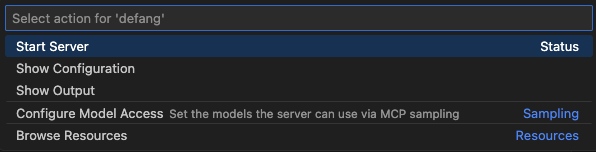
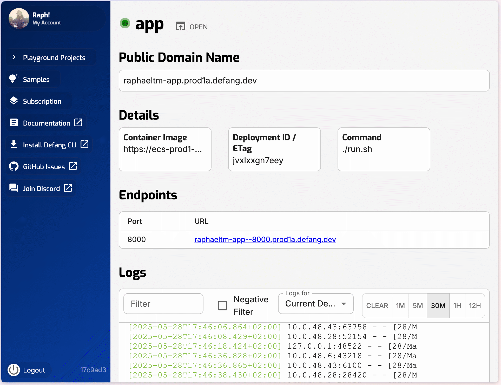

# Deploying with the Defang MCP Server

This tutorial will show you how to deploy your services with the [Defang MCP Server](https://docs.defang.io/docs/concepts/mcp.md).

## Prerequisites[​](#prerequisites "Direct link to Prerequisites")

* [The Defang MCP Server](https://docs.defang.io/docs/concepts/mcp.md#installation)
* [A Defang Account](https://docs.defang.io/docs/concepts/authentication.md)
* [A `compose.yaml` file in your project](https://docs.docker.com/compose/gettingstarted/)

Open your project with an IDE that has the [Defang MCP Server](https://docs.defang.io/docs/concepts/mcp.md) installed.

tip

If the Defang MCP server doesn’t start automatically, try starting or restarting it from your IDE settings. 

## AWS[​](#aws "Direct link to AWS")

### Step 1 - Collect your credentials[​](#step-1---collect-your-credentials "Direct link to Step 1 - Collect your credentials")

There are many ways to authenticate with your [AWS account](https://docs.aws.amazon.com/cli/latest/userguide/cli-chap-authentication.html). We recommend using the [`aws login`](https://docs.aws.amazon.com/signin/latest/userguide/command-line-sign-in.html) cli command to create a profile with short-lived credentials. Defang can then use this profile to deploy your services.

tip

You can use the AWS CLI to verify that you've authenticated to AWS by running `aws sts get-caller-identity`. This will show you the currently authenticated account ID. (The AWS CLI is not required in order to use Defang with AWS)

### Step 2 - Create a stack for deployment on AWS[​](#step-2---create-a-stack-for-deployment-on-aws "Direct link to Step 2 - Create a stack for deployment on AWS")

When you deploy your project, you will need to create a new [stack](https://docs.defang.io/docs/concepts/stacks.md). This stack is an isolated deployment of your project in a specific cloud account and region. Defang will ask you what which region you want the stack to be deployed to, and also what you want the stack to be called. You will also be asked to provide your AWS credentials. If you have created a profile, you can mention it by name, and defang will use the credentials from that profile. Your credentials are never stored by Defang.

note

If you want to use AWS Access Keys, we recommend using `aws configure` to set them up in a profile, rather than passing them directly to Defang.

### Step 3 - Deploy[​](#step-3---deploy "Direct link to Step 3 - Deploy")

Once the setup is complete, ask the AI assistant to deploy your project.

### Step 4 - Inspect your deployment[​](#step-4---inspect-your-deployment "Direct link to Step 4 - Inspect your deployment")

You can check the status of your deployment by using the [Defang Services tool](https://docs.defang.io/docs/concepts/mcp.md#services) or you can inspect the resources created in your AWS Dashboard.

## GCP[​](#gcp "Direct link to GCP")

### Prerequisites[​](#prerequisites-1 "Direct link to Prerequisites")

* [gcloud CLI](https://cloud.google.com/sdk/docs/install)
* [GCP Application Default Credentials](https://cloud.google.com/docs/authentication/set-up-adc-local-dev-environment)

### Step 1 - Collect your credentials[​](#step-1---collect-your-credentials-1 "Direct link to Step 1 - Collect your credentials")

After signing in to your GCP account, select an existing project or [create a new project](https://developers.google.com/workspace/guides/create-project). Make sure [billing is enabled](https://cloud.google.com/billing/docs/how-to/modify-project). Then, note down the project ID for the next step.

### Step 2 - Setup Defang for GCP[​](#step-2---setup-defang-for-gcp "Direct link to Step 2 - Setup Defang for GCP")

In your chat window, ask the AI assistant to set up Defang for GCP deployment, providing the GCP project ID you noted in [Step 1](#step-1---collect-your-credentials-1).

### Step 3 - Deploy[​](#step-3---deploy-1 "Direct link to Step 3 - Deploy")

Once the setup is complete, ask the AI assistant to deploy your project.

### Step 4 - Inspect your deployment[​](#step-4---inspect-your-deployment-1 "Direct link to Step 4 - Inspect your deployment")

You can check the status of your deployment by using the [Defang Services tool](https://docs.defang.io/docs/concepts/mcp.md#services) or you can inspect the resources created in your GCP Dashboard.

## Azure[​](#azure "Direct link to Azure")

### Prerequisites[​](#prerequisites-2 "Direct link to Prerequisites")

* [Azure CLI](https://learn.microsoft.com/en-us/cli/azure/install-azure-cli)
* [Azure Application Default Credentials](https://learn.microsoft.com/en-us/cli/azure/authenticate-azure-cli)

### Step 1 - Collect your credentials[​](#step-1---collect-your-credentials-2 "Direct link to Step 1 - Collect your credentials")

After signing in to your Azure account, select an existing subscription or [create a new one](https://learn.microsoft.com/en-us/azure/cost-management-billing/manage/create-subscription). Make sure billing is enabled. Then, note down the subscription ID for the next step.

### Step 2 - Setup Defang for Azure[​](#step-2---setup-defang-for-azure "Direct link to Step 2 - Setup Defang for Azure")

In your chat window, ask the AI assistant to set up Defang for Azure deployment, providing the Azure subscription ID you noted in [Step 1](#step-1---collect-your-credentials-2).

### Step 3 - Deploy[​](#step-3---deploy-2 "Direct link to Step 3 - Deploy")

Once the setup is complete, ask the AI assistant to deploy your project.

### Step 4 - Inspect your deployment[​](#step-4---inspect-your-deployment-2 "Direct link to Step 4 - Inspect your deployment")

You can check the status of your deployment by using the [Defang Services tool](https://docs.defang.io/docs/concepts/mcp.md#services) or you can inspect the resources created in your [Azure Portal](https://portal.azure.com/).

## Playground[​](#playground "Direct link to Playground")

### Step 1 - Setting your provider[​](#step-1---setting-your-provider "Direct link to Step 1 - Setting your provider")

In your chat window, ask the AI assistant to set up Defang for Playground deployment.

### Step 2 - Deploy[​](#step-2---deploy "Direct link to Step 2 - Deploy")

Once the setup is complete, ask the AI assistant to deploy your project.

### Step 3 - Inspect your deployment[​](#step-3---inspect-your-deployment "Direct link to Step 3 - Inspect your deployment")

You can check the status of your deployment by using the [Defang Services tool](https://docs.defang.io/docs/concepts/mcp.md#services) or you can inspect the the project on the [Defang portal](https://portal.defang.io/projects). 
