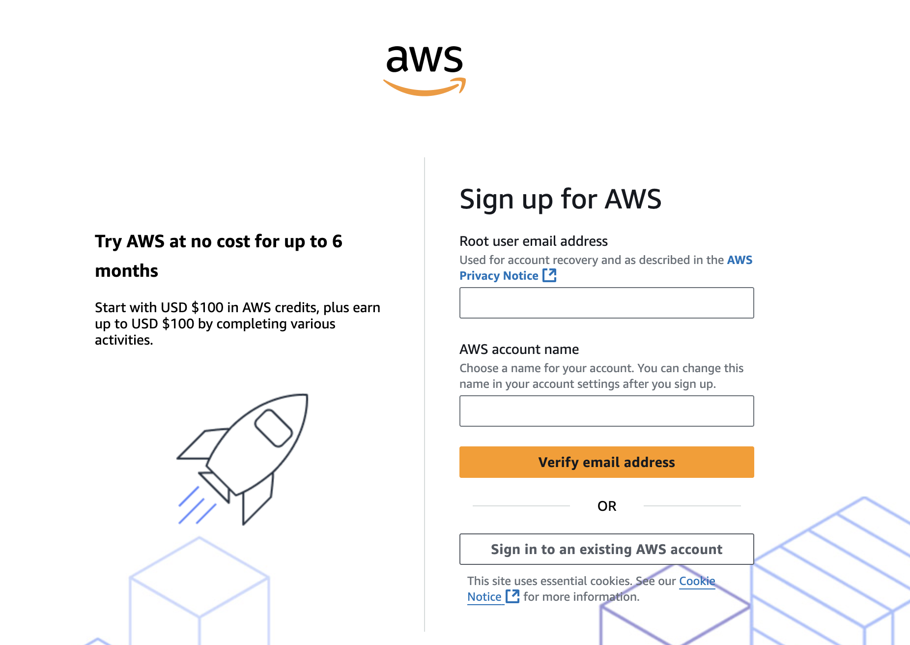

# Setting Up Your AWS Account

## Prerequisites[​](#prerequisites "Direct link to Prerequisites")

* [AWS CLI](https://docs.aws.amazon.com/cli/latest/userguide/getting-started-install.html#getting-started-install-instructions)

Follow these steps to set up your Amazon Web Services (AWS) account for deploying applications with Defang.

***

### Step 1: Create Your AWS Account[​](#step-1-create-your-aws-account "Direct link to Step 1: Create Your AWS Account")

If you don't already have an AWS account, start by creating one using the [AWS account creation flow](https://signin.aws.amazon.com/signup?request_type=register). If you already have an account skip to the next step.



***

### Step 2: Authenticate with AWS[​](#step-2-authenticate-with-aws "Direct link to Step 2: Authenticate with AWS")

Depending on where you are deploying from, there are different ways to authenticate with your AWS account.

#### Deploying from your Local Machine[​](#deploying-from-your-local-machine "Direct link to Deploying from your Local Machine")

We recommend using the AWS CLI to authenticate with your AWS account. If you haven't already installed the AWS CLI, follow the [installation instructions](https://docs.aws.amazon.com/cli/latest/userguide/getting-started-install.html).

Once the AWS CLI is installed, run the following command to authenticate:

```
aws login
```

This will create an AWS Profile with short-lived credentials that Defang can use to deploy your services.

If you need to deploy with an AWS Access Key and Secret Access Key, we recommend using `aws configure` to set them up in a profile:

```
aws configure
```

#### Deploying from GitHub Actions[​](#deploying-from-github-actions "Direct link to Deploying from GitHub Actions")

When deploying from GitHub Actions, you will need to create an IAM user with programmatic access and the necessary permissions to deploy your services. See our guide on [Setting Up GitHub Actions for AWS Deployment](https://docs.defang.io/docs/tutorials/deploying-from-github-actions/to-aws.md) for detailed instructions.

***

You are now ready to deploy! See the [Deploy to AWS tutorial](https://docs.defang.io/docs/tutorials/deploy-to-aws.md) for next steps.
