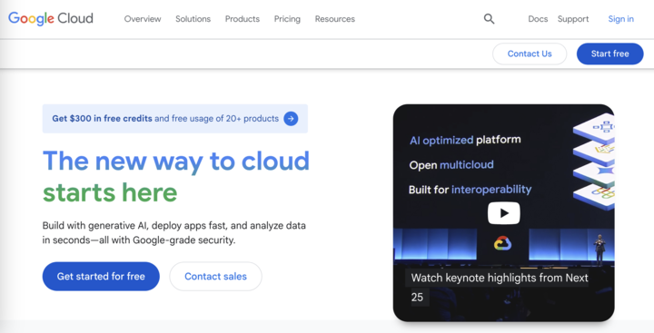
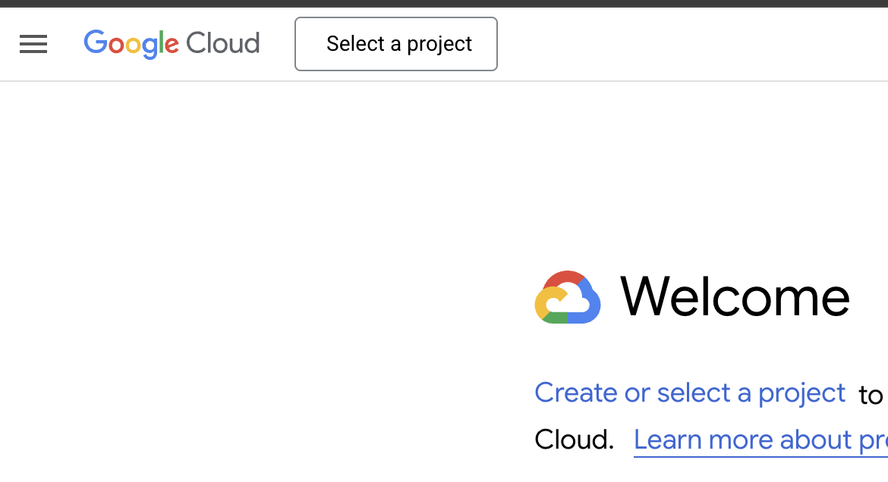
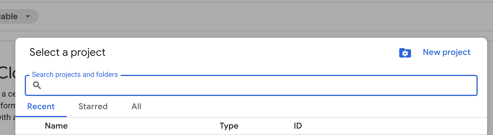
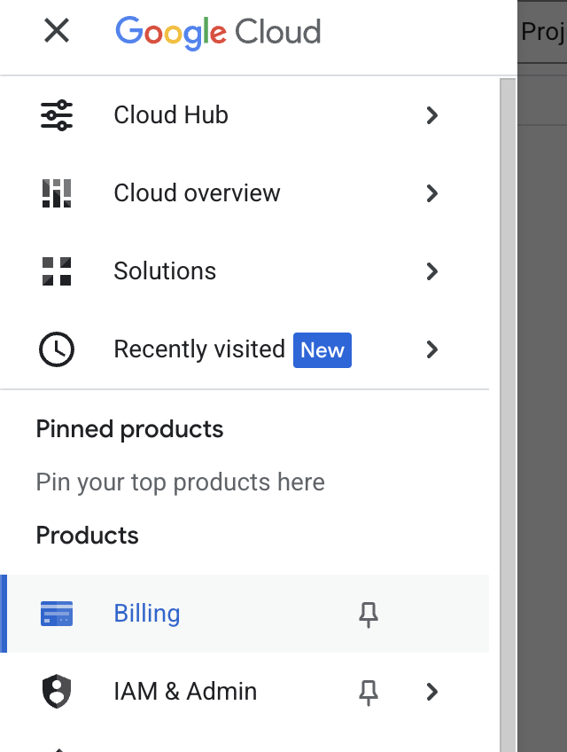
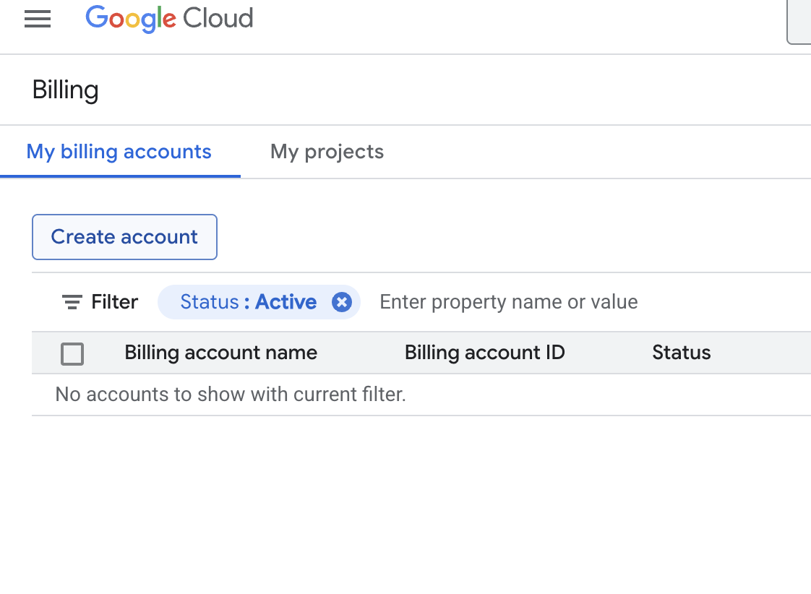
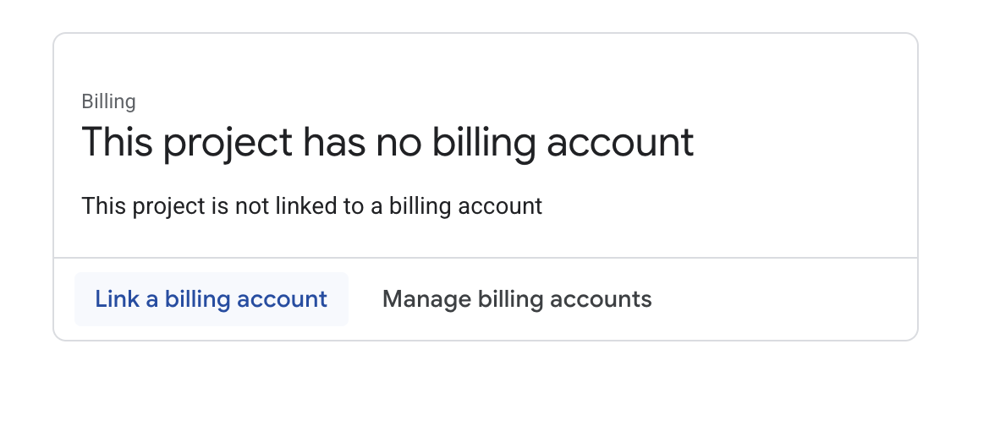
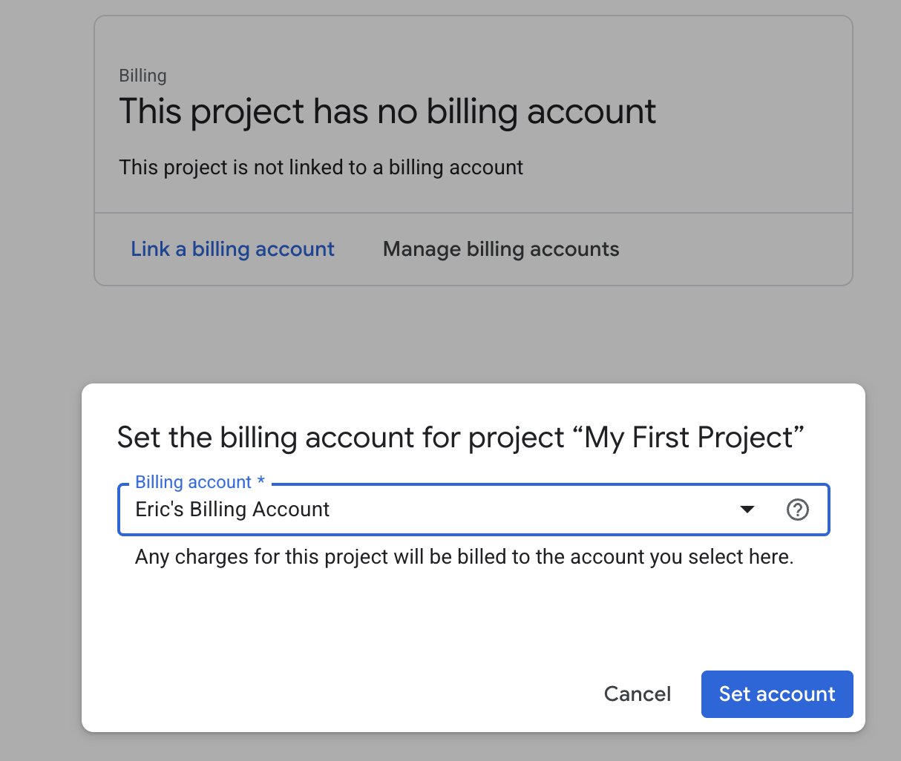

# Setting Up Your GCP Account

Follow these steps to set up your Google Cloud Platform (GCP) account for deploying applications with Defang.

***

### Step 1: Create Your GCP Account[​](#step-1-create-your-gcp-account "Direct link to Step 1: Create Your GCP Account")

Start by creating a Google Cloud account using the [GCP account creation flow](https://cloud.google.com/). If you already have an account skip to the next step.



Google GCP sign up page

***

### Step 2: Create a GCP Project[​](#step-2-create-a-gcp-project "Direct link to Step 2: Create a GCP Project")

To deploy apps using Defang, you need a GCP project. Projects help organize related resources such as services, IAM policies, quotas, and billing.

If you already have a project, skip to [Step 3](#step-3-create-your-billing-account).

To create a new project:

1. Visit the [GCP Console](https://console.cloud.google.com/).
2. Click the project selector button (it may say **"Select a project"** or display a previous project name).



**Select project button to open the project dialog**

3. Follow the prompts to create a new project.

info

Take note of your **Project ID** — you’ll need it later when setting the `GCP_PROJECT_ID` environment variable.



Create a new project in the dialog

***

### Step 3: Create Your Billing Account[​](#step-3-create-your-billing-account "Direct link to Step 3: Create Your Billing Account")

Billing accounts let Google allocate costs to specific entities or users. You’ll need one to deploy services.

1. In the [GCP Console](https://console.cloud.google.com/), open the navigation menu.
2. Select **Billing**.



Billing menu option

1. In the billing side panel, select **Manage billing accounts**, then click **Create account**.
2. Follow the steps to create a billing account. A credit card is required.



Billing management page

***

### Step 4: Link Your Project to the Billing Account[​](#step-4-link-your-project-to-the-billing-account "Direct link to Step 4: Link Your Project to the Billing Account")

Once your project and billing account are created, link them together:

1. In the GCP Console, select your project from the project selector.
2. Open the **Billing** section again from the left sidebar.
3. Click **Link a billing account**.



Link billing account dialog

1. Choose the billing account to link.



Select a billing account to link

***

### Step 5: Set Up Your GCP CLI[​](#step-5-set-up-your-gcp-cli "Direct link to Step 5: Set Up Your GCP CLI")

To complete your setup, install the **gcloud CLI** by following the [installation guide](https://cloud.google.com/sdk/docs/install).

After installation, authenticate with:

```
gcloud auth application-default login
```

This will generate your **application default credentials** used during deployment.

***

Now you're ready to deploy! See the [Deploy to GCP tutorial](https://docs.defang.io/docs/tutorials/deploy-to-gcp.md) for next steps.
