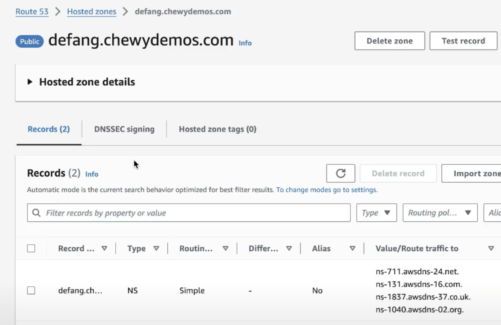
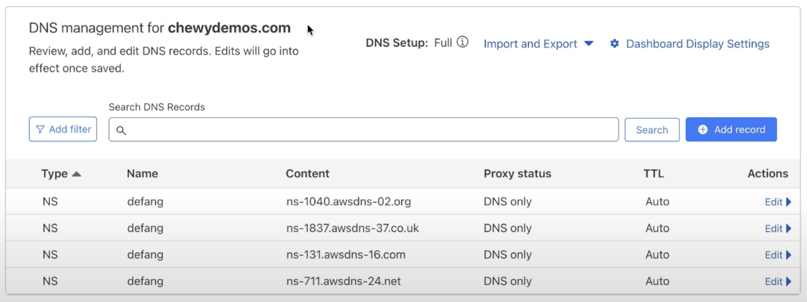
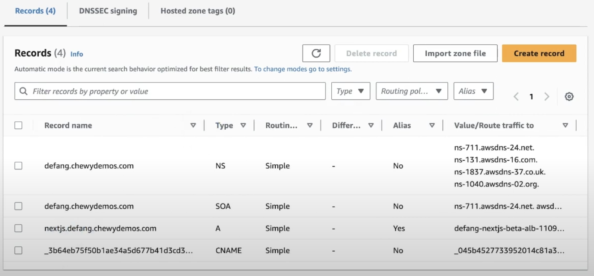

# How to Use Your Own Domain With AWS

This tutorial will show you how to set up and use your own domain when deploying to AWS using Defang.

There are two main approaches to using custom domains with Defang on AWS:

1. **Using Route 53 for DNS management** (Recommended) - Automatic DNS and certificate management
2. **Using your existing DNS provider** - Manual DNS configuration with CNAMEs

[YouTube video player](https://www.youtube.com/embed/n4RlMpsdTbs?si=_Ru6tobSbi9LT4Q1)

## Prerequisites[​](#prerequisites "Direct link to Prerequisites")

* [A Defang Account](https://docs.defang.io/docs/concepts/authentication.md)
* [The Defang CLI](https://docs.defang.io/docs/intro/getting-started.md#install-the-defang-cli)
* [AWS Account Credentials](https://docs.defang.io/docs/tutorials/setting_up_your_aws_account.md)

## Approach 1: Using Route 53 (Recommended)[​](#approach-1-using-route-53-recommended "Direct link to Approach 1: Using Route 53 (Recommended)")

This approach is ideal if you want automatic DNS and certificate management, especially for frequently deployed environments like staging.

**Benefits:**

* No need to run `defang cert generate` after each deployment
* DNS records are automatically created and updated
* SSL certificates are automatically provisioned and renewed
* Perfect for staging environments that are frequently deployed and torn down

## Step 1 - Set up a Hosted Zone in AWS Route 53[​](#step-1---set-up-a-hosted-zone-in-aws-route-53 "Direct link to Step 1 - Set up a Hosted Zone in AWS Route 53")

info

**If you purchased your domain with AWS, you can skip this step.**

For Defang to be able to manage your domain, you need to create a [public hosted zone](https://docs.aws.amazon.com/Route53/latest/DeveloperGuide/CreatingHostedZone.html) in AWS Route 53. It should list four AWS nameservers and should look like this:



## Step 2 - Configure your DNS settings in your domain registrar[​](#step-2---configure-your-dns-settings-in-your-domain-registrar "Direct link to Step 2 - Configure your DNS settings in your domain registrar")

info

**If you purchased your domain with AWS, you can skip this step.**

You'll need to create NS records in your domain registrar that point to the AWS Route 53 name servers which we got in the previous step. For example, in CloudFlare, the NS records would look like this:



## Step 3 - Set up Your Compose File[​](#step-3---set-up-your-compose-file "Direct link to Step 3 - Set up Your Compose File")

In your Compose file, specify the domain name you want to use, for example:

```
services:
    web:
        domainname: nextjs.defang.chewydemos.com
        build:
            context: ./web
            dockerfile: Dockerfile
        ports:
        - mode: ingress
          target: 3000
          protocol: http
```

## Step 4 - Deploy[​](#step-4---deploy "Direct link to Step 4 - Deploy")

Run the following command to deploy your service:

```
defang compose up
```

This will deploy your service and set up the necessary DNS records in Route 53 as seen in the screenshot below as well as provision SSL certificates. You can now access your service at the domain you specified in your Compose file.



***

## Approach 2: Using Your Existing DNS Provider (CloudFlare, Namecheap, etc.)[​](#approach-2-using-your-existing-dns-provider-cloudflare-namecheap-etc "Direct link to Approach 2: Using Your Existing DNS Provider (CloudFlare, Namecheap, etc.)")

If you prefer to keep your DNS with your current provider (like CloudFlare or Namecheap), you can use CNAME records to point to Defang-provided domains. This approach is particularly useful for frequently deployed environments.

### Option A: Direct Custom Domain with Certificate Generation[​](#option-a-direct-custom-domain-with-certificate-generation "Direct link to Option A: Direct Custom Domain with Certificate Generation")

1. Add the `domainname` to your service definition in your Compose file:

   ```
   services:
       web:
           domainname: staging.example.com
           ports:
           - mode: ingress
             target: 3000
             protocol: http
   ```

2. Deploy your service:

   ```
   defang compose up
   ```

3. Generate an SSL certificate:

   ```
   defang cert generate
   ```

   This command will provide instructions for DNS configuration.

4. **Important:** You'll need to run `defang cert generate` again after each `defang compose up` to recreate SSL certificates.

### Option B: CNAME to Defang Domain (Recommended for Staging)[​](#option-b-cname-to-defang-domain-recommended-for-staging "Direct link to Option B: CNAME to Defang Domain (Recommended for Staging)")

This approach avoids having to reconfigure your external DNS record for each deployment, making it ideal for staging environments that are frequently torn down and redeployed.

1. Keep the `domainname` set to your custom domain in your service definition — `defang cert generate` needs it to know which hostname to issue a certificate for:

   ```
   services:
       web:
           domainname: staging.example.com
           ports:
           - mode: ingress
             target: 3000
             protocol: http
   ```

2. Deploy your service:

   ```
   defang compose up
   ```

3. After deployment, Defang provides you with a stable domain for your service: `service-name--port.project-name.username.defang.app`. Unlike the AWS load balancer's domain, this one doesn't change across redeploys.

4. In your DNS provider (CloudFlare, Namecheap, etc.), create a CNAME record:

   * **Name**: `staging` (or your desired subdomain)
   * **Target**: The `defang.app` domain from the previous step
   * **Example**: `staging.example.com` → `web--3000.myproject.myuser.defang.app`

5. Generate the SSL certificate:

   ```
   defang cert generate
   ```

6. For subsequent deployments, run `defang compose up` followed by `defang cert generate` again to recreate the certificate. Your CNAME record will continue to work without needing DNS changes.

### Managing Multiple Environments[​](#managing-multiple-environments "Direct link to Managing Multiple Environments")

To maintain separate staging and production environments simultaneously, use project names:

**Using the `name` field in your Compose file:**

```
name: myapp-staging

services:
    web:
        ports:
        - mode: ingress
          target: 3000
          protocol: http
```

**Or using the `--project-name` flag:**

```
defang compose up --project-name myapp-staging
defang compose up --project-name myapp-production
```

Each project name creates a separate deployment with its own domain:

* Staging: `web--3000.myapp-staging.username.defang.app`
* Production: `web--3000.myapp-production.username.defang.app`

tip

Create CNAMEs for both environments:

* `staging.example.com` → `web--3000.myapp-staging.username.defang.app`
* `app.example.com` → `web--3000.myapp-production.username.defang.app`

Then you can deploy and tear down your staging environment as needed without touching DNS.

***

For a deeper discussion of how to use a custom domain with Defang, see our [Domain](https://docs.defang.io/docs/concepts/domains.md) concept docs.
