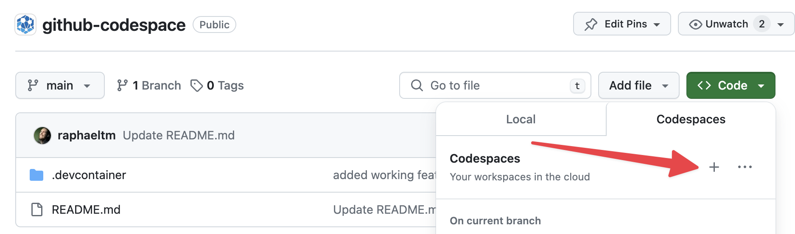
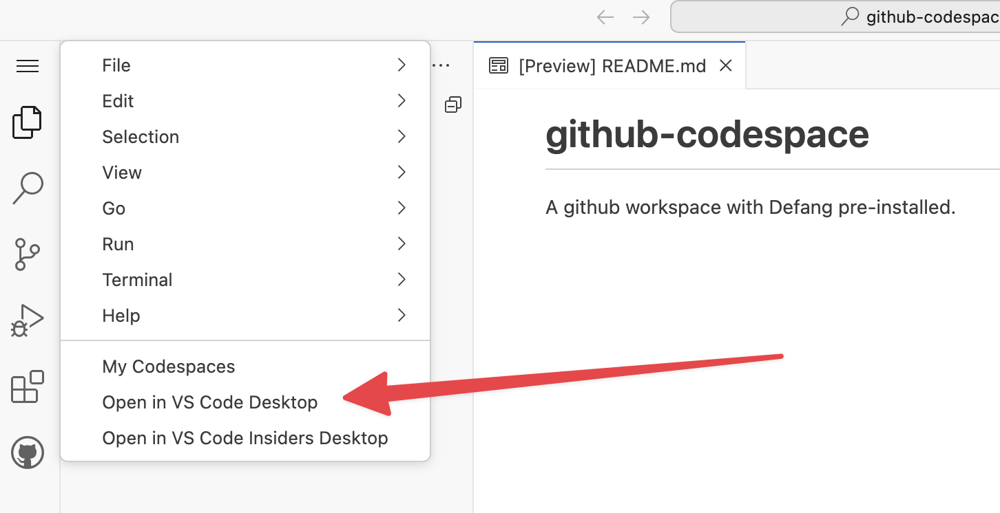
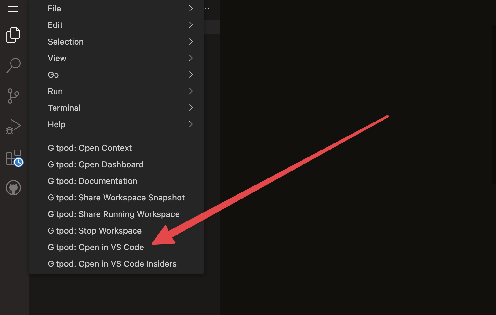
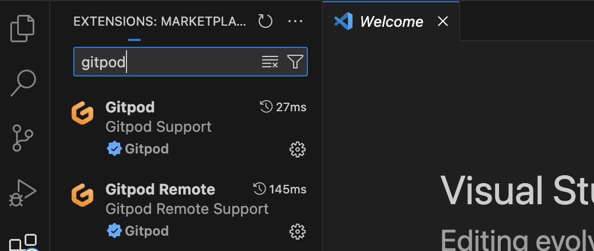

# Using Codespaces and Gitpod

This tutorial will guide you to set up Defang in both GitHub Codespaces and Gitpod.

[YouTube video player](https://www.youtube.com/embed/71pmCfLdxTg?si=Q9YIESYEUNTBFBIy)

## Using Codespaces With Defang[​](#using-codespaces-with-defang "Direct link to Using Codespaces With Defang")

### Step 1 - Clone the Defang Codespace Project[​](#step-1---clone-the-defang-codespace-project "Direct link to Step 1 - Clone the Defang Codespace Project")

Start by cloning the [Defang GitHub-Codespace](https://github.com/DefangLabs/github-codespace) repo and pushing it to your own account. This repository is configured with a Codespace that has Defang pre-installed.

### Step 2 - Create a Codespace[​](#step-2---create-a-codespace "Direct link to Step 2 - Create a Codespace")

Once you've pushed to your own GitHub repo, you'll be able to create a Codespace by clicking the Code button, selecting the Codespaces tab, and clicking the + icon. This will set up a development environment with Defang already installed, which might take a few minutes.



### Step 3 - Open in VS Code Desktop[​](#step-3---open-in-vs-code-desktop "Direct link to Step 3 - Open in VS Code Desktop")

For the `defang login` command to work correctly, you must open the Codespace in VS Code desktop. This is required because the login process is designed to run on localhost.



### Step 4 - Run Defang Login[​](#step-4---run-defang-login "Direct link to Step 4 - Run Defang Login")

Within a VS Code desktop terminal, execute the following command.

```
defang login
```

Although it may initially refuse to connect on your localhost, going back will show a "successfully logged in" message, confirming that you're logged into Defang.

### Step 5 - Verify Running Services[​](#step-5---verify-running-services "Direct link to Step 5 - Verify Running Services")

Now that you're logged in, you can use Defang commands. You can test that everything is working properly by running `defang ls` to list your running services.

## Using Gitpod With Defang[​](#using-gitpod-with-defang "Direct link to Using Gitpod With Defang")

### Step 1 - Clone the Defang Gitpod Workspace Project[​](#step-1---clone-the-defang-gitpod-workspace-project "Direct link to Step 1 - Clone the Defang Gitpod Workspace Project")

Start by cloning the [Defang Gitpod-Workspace](https://github.com/DefangLabs/gitpod-workspace) repo and pushing it to your own GitHub, GitLab, or BitBucket account. This repository includes a Workspace configuration that pre-installs Defang.

### Step 2 - Initialize a Gitpod Workspace[​](#step-2---initialize-a-gitpod-workspace "Direct link to Step 2 - Initialize a Gitpod Workspace")

Navigate `https://gitpod.io/#<your-repo-url>` to create your new workspace. In the repository, we have a YAML file indicating that we are using a pre-built Dockerfile which installs Defang CLI for you.

### Step 3 - Lauch VS Code from Gitpod[​](#step-3---lauch-vs-code-from-gitpod "Direct link to Step 3 - Lauch VS Code from Gitpod")

Open VS Code from Gitpod, you will likely need to have the Gitpod VS Code extension installed.





### Step 4 - Run Defang Login[​](#step-4---run-defang-login-1 "Direct link to Step 4 - Run Defang Login")

Within a VS Code desktop terminal, execute the following command.

```
defang login
```

### Step 5 - Verify Running Services[​](#step-5---verify-running-services-1 "Direct link to Step 5 - Verify Running Services")

Now that you're logged in, you can use Defang commands. You can test that everything is working properly by running `defang ls` to list your running services.
